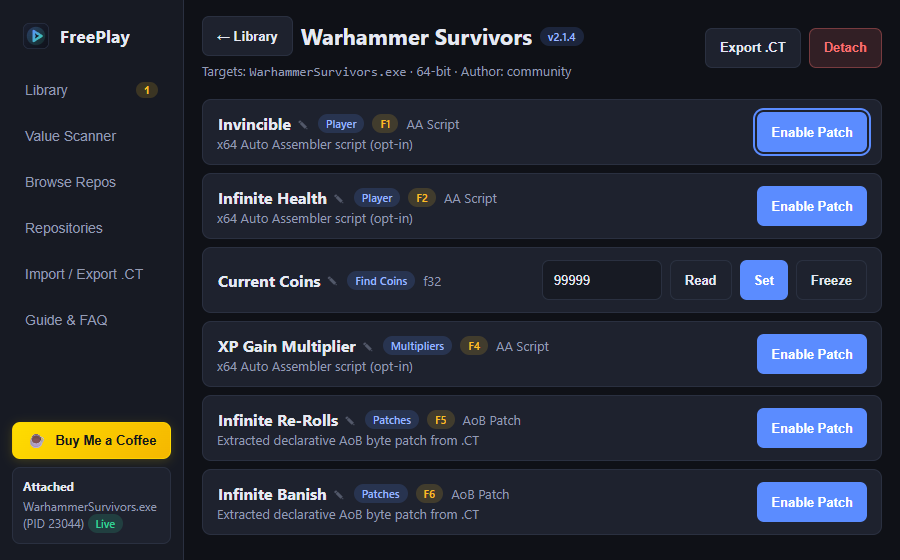
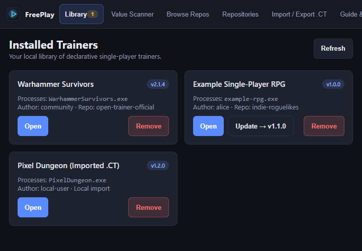
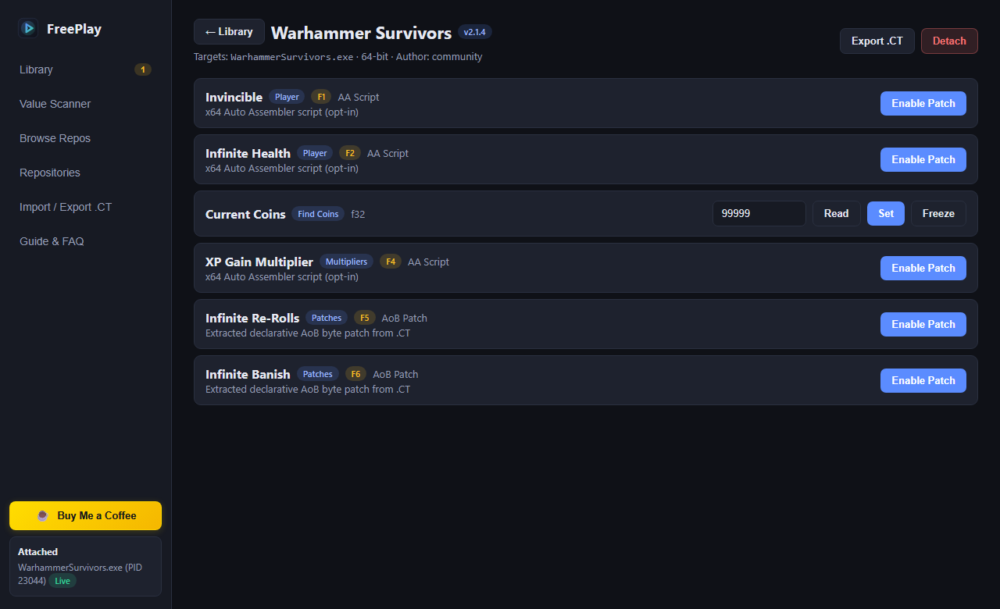
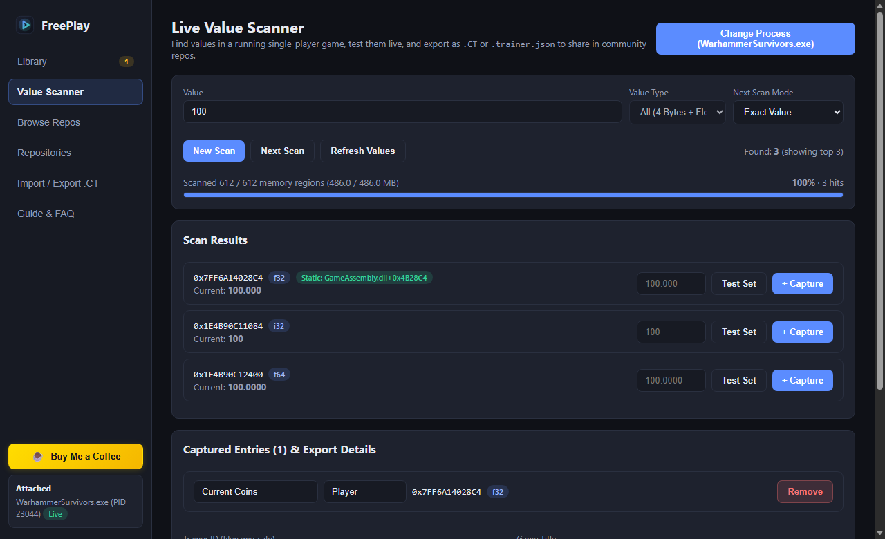
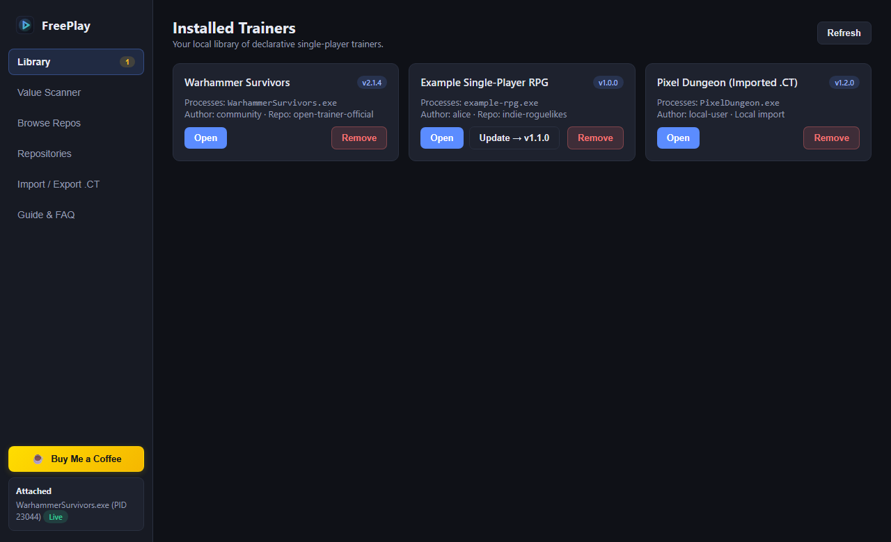

<div align="center">


# FreePlay

**Free, open-source single-player game trainer hub powered by community repositories.**  
No subscriptions. No paywalls. Import Cheat Engine `.CT` tables, scan values live, or subscribe to community trainer repos—just like Tachiyomi.

[](../../releases/latest)
[](https://buymeacoffee.com/orcecso)
[](LICENSE)

</div>

---

## Quick Start (Just Download & Play)

No coding or setup required:

1. Open the **[Releases](../../releases/latest)** page on the right side of this repository.
2. Download the build for your device:
   - **Windows & Windows Handhelds (ROG Ally, Legion Go, MSI Claw):** Download **`FreePlay-portable-x64.exe`** (or the `.msi` / `.exe` installer) and run it.
   - **Steam Deck / SteamOS / Bazzite (Recommended):** Download **`FreePlay-linux-x64-steamdeck.tar.gz`**, extract it in Desktop Mode, and run `./install-steamdeck.sh` (installs cleanly to `~/.local/bin/freeplay`, adds a desktop launcher, and grants `CAP_SYS_PTRACE` without modifying the read-only OS partition).
   - **Linux Desktop:** Download the **`.AppImage`** or **`.deb`** package (or the portable `.tar.gz` above).
3. Launch your single-player game, then do **any** of the following:
   - **Add a Community Repo** in **Repositories** → install trainers with one click from **Browse Repos**.
   - **Import a Cheat Engine `.CT` file** in **Import / Export .CT** → click **Pick Process...** to choose your running game (works for both native Linux and Steam Proton `.exe` games!).
   - **Find values yourself** using the built-in **Value Scanner** (`All: 4 Bytes + Float + Double`), test them live, and export as `.CT` or `.trainer.json`.

> **Single-Player Only:** FreePlay uses standard user-mode OS memory APIs (Win32 on Windows; `/proc` & `process_vm` on Linux/SteamOS) for offline/single-player games. It does not include kernel drivers or anti-cheat bypasses.

> **Experimental Linux & Handheld Builds — Testers, Contributors & Support Wanted!**  
> The new **Linux**, **Steam Deck (SteamOS)**, and **portable handheld PC** builds (`v0.3.0`) have **not yet been fully tested on physical Linux or Steam Deck hardware**.  
> - **Have a Steam Deck, Linux PC, ROG Ally, or Legion Go?** Please try the build, [open an issue](../../issues) with what works or breaks, or submit a Pull Request!  
> - **Want to help fund test hardware & development?** FreePlay is 100% free and open-source—consider supporting the project via **[Buy Me a Coffee](https://buymeacoffee.com/orcecso)** so we can test and polish Linux/handheld support directly on real hardware.

### What's New in `v0.3.0` (Linux & Handheld Edition)
- **Native Linux & Steam Deck Memory Engine:** Full `/proc/<pid>/maps`, `/proc/<pid>/mem`, and `process_vm_readv`/`writev` backend with live Value Scanner, Freezing, Pointer Chains, and reversible AoB Byte Patches.
- **Automatic Steam Proton / Wine `.exe` Detection:** Detects Windows `.exe` names and PE modules inside Proton processes so existing Windows `.CT` tables and community repos can work on Steam Deck.
- **Steam Deck Portable Installer (`install-steamdeck.sh`):** Installs cleanly into `~/.local/bin/freeplay` (safe for read-only SteamOS/Bazzite root filesystems), creates a desktop entry for Gaming Mode ("Add to Steam"), and grants `CAP_SYS_PTRACE` without running as root.
- **Handheld-Ready UI & Built-in Controller Navigation:** Responsive layouts for `1280×800` and compact `720×500` handheld screens, touch-friendly 40px targets, crisp focus outlines, and native Gamepad API controls (**LB/RB** switch tabs, **D-Pad/Left Stick** move focus, **A** select, **B** back, **Right Stick** scroll).
- **Safe Exit Confirmation:** Warns before closing FreePlay when attached to a live game and cleanly detaches/restores memory.
- **Automated Multi-OS CI Releases:** Every release tag builds Windows (`.exe`, `.msi`, portable) and Linux (`.AppImage`, `.deb`, and Steam Deck `.tar.gz`) with unified SHA-256 checksums.

### Steam Deck & Handheld Tips
- **Proton Games Use Windows Trainers:** Because Proton runs the same Windows x86_64 `.exe`, FreePlay automatically detects Proton game `.exe` names so existing Windows `.CT` tables, AoB byte patches, and community repos work out of the box on Steam Deck.
- **Gaming Mode:** After running `./install-steamdeck.sh`, right-click **FreePlay** in Desktop Mode's Application Menu → **Add to Steam** to switch between your game and FreePlay in Gaming Mode.
- **Built-in Controller Navigation:** Use **LB / RB** to switch tabs, **D-Pad / Left Stick** to move focus, **A** to select, **B** to go back, and **Right Stick** to scroll.
- **Linux Note:** Value scanning, freezing, pointer chains, and AoB byte patches work natively on Linux/SteamOS. Auto Assembler remote code caves (`alloc`) are currently Windows-only.

---

## Coming from Cheat Engine? (`.CT` Users & Table Creators)

If you've used **Cheat Engine** before—or if you're a creator who already builds and shares `.CT` tables—you'll feel right at home:

- **Import your existing `.CT` files directly:** FreePlay reads Cheat Engine `.CT` XML tables out of the box—including static addresses, multi-level pointer chains, `aobscanmodule` byte patches, and opt-in x64 Auto Assembler code caves (`alloc`, `registersymbol`, `movss`/`mulss`, etc.).
- **Safer by default:** `<LuaScript>` and `LuaCall` blocks are blocked automatically so community tables can't silently run arbitrary scripts on your PC.
- **Create once, share everywhere:** Use the built-in **Live Value Scanner** to find HP, Gold, or XP in a running game, then export both a **Cheat Engine `.CT` file** and a **`.trainer.json`** (complete with a ready-to-paste `index.json` snippet + SHA-256 hash) to share in any community GitHub repository.

---

## Video Demos

- **Live Value Scanner Demo:** [Watch on YouTube](https://youtu.be/AXGxpTdPiEA) — How to attach to a running game, scan and narrow down values, and edit/freeze them live.

[](https://youtu.be/AXGxpTdPiEA)

*More demos coming soon (including importing/adding a Cheat Engine `.CT` file and setting up community repositories).*

---

## Screenshots

### Handheld & Steam Deck UI Layout (New in `v0.3.0`)
Responsive layouts built for Steam Deck (`1280×800`), ROG Ally, Legion Go, and compact portable viewports (`720×500`)—with touch-friendly buttons, crisp focus outlines, and built-in gamepad controls (**LB/RB** tabs, **D-Pad** navigate, **A** select, **B** back):

| Steam Deck / Handheld Controls (`900×560`) | Compact Portable Top-Nav (`720×500`) |
| :---: | :---: |
|  |  |

### Live Trainer Controls & One-Click Attach
Attach to your running game, toggle AoB patches and opt-in x64 Auto Assembler scripts, or read/set/freeze live values—and export back to `.CT` anytime.



### Built-In Live Value Scanner (with Real-Time Progress)
Pick any running game from the filtered Process Picker (Windows system processes hidden automatically), scan in **All (`4 Bytes + Float + Double`)** mode with a live progress bar, test values in-game, and capture them to export as `.CT` or `.trainer.json`.



### Library & Tachiyomi-Style Community Repositories
Keep all your installed trainers in one clean library with automatic version-update badges, or browse and install SHA-256 verified community trainers by game title, `.exe`, or Steam AppID.

| Installed Library | Browse Community Catalog |
| :---: | :---: |
|  |  |

---

## Key Features

- **Zero Bundled Trainers (Tachiyomi Model):** Add any GitHub `index.json` URL in **Repositories**, refresh catalogs, and install/update trainers with SHA-256 integrity checks.
- **Smart Process Picker:** Lists your running third-party apps and games with their window titles right at the top—no need to guess or type `.exe` filenames.
- **Cheat Engine `.CT` Import & Export:** Bring existing `.CT` tables into FreePlay or export your own discoveries back to `.CT`.
- **Live Value Scanner:** Supports `All (4 Bytes + Float + Double)`, `i32`, `f32`, `f64`, `i64`, `i16`, `u8`, plus `Exact`, `Increased`, `Decreased`, `Changed`, and `Unchanged` filtering with live progress.
- **Clean Cleanup:** Disabling a toggle or detaching automatically unfreezes values, restores original bytes, and frees allocated memory caves.

---

## Hosting Your Own Community Trainer Repo

Anyone can host a trainer repository on GitHub for free (zero backend required):

1. Fork or copy the template in [`examples/sample-repo/`](examples/sample-repo/).
2. Put your `.trainer.json` files inside `trainers/` and list them in `index.json` (FreePlay's **Value Scanner** generates the exact `index.json` entry and SHA-256 hash for you!).
3. Share your raw GitHub `index.json` URL (e.g. `https://raw.githubusercontent.com/<user>/<repo>/main/index.json`) so anyone can paste it into **Repositories** in FreePlay.

---

## Support FreePlay

FreePlay is 100% free, open-source, and has zero paywalls or subscriptions. If it saved you time or money, consider supporting ongoing development:

[](https://buymeacoffee.com/orcecso)

---

## Developer Guide (Building from Source)

### Prerequisites
- **Windows 10/11** (64-bit) or **Linux / SteamOS** (64-bit; requires `libwebkit2gtk-4.1-dev`, `libayatana-appindicator3-dev`, `librsvg2-dev`, `libssl-dev`, `patchelf` for Tauri builds)
- **Rust** (`rustup` / `cargo`)
- **Node.js 20+** (`npm`)

### Project Layout
```text
open-trainer/
├── Cargo.toml
├── docs/screenshots/             # README showcase screenshots
├── examples/
│   ├── sample.trainer.json       # Example declarative trainer manifest
│   └── sample-repo/              # Template community repo (index.json + trainers/)
├── crates/
│   ├── trainer-core/             # User-mode Windows memory engine, pointer chains, AoB & live scanner
│   ├── trainer-schema/           # JSON trainer schema, .CT XML converter & x64 Auto Assembler runtime
│   ├── trainer-repo/             # Community repo catalog, HTTP/local fetcher, SHA-256 verifier & store
│   └── dummy-target/             # Local test process for end-to-end integration tests
└── app/                          # Tauri v2 + React + TypeScript desktop app
    ├── src/                      # React frontend
    └── src-tauri/                # Tauri v2 Rust backend
```

### Run Backend Tests
```powershell
cargo test --workspace
```

### Run Desktop App in Dev Mode
```powershell
cd app
npm install
npm run tauri dev
```

### Build Release Executable
```powershell
cd app
npm install
npm run tauri build
```
